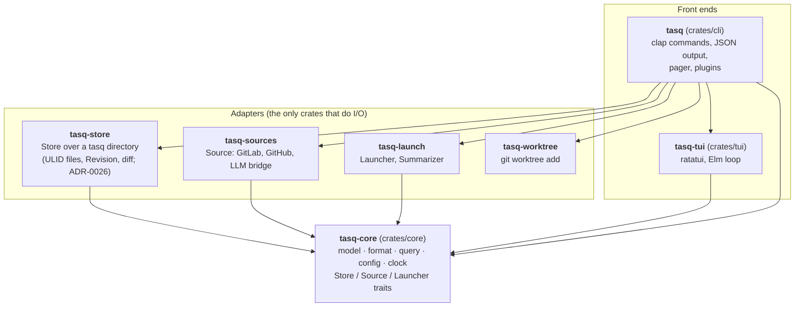
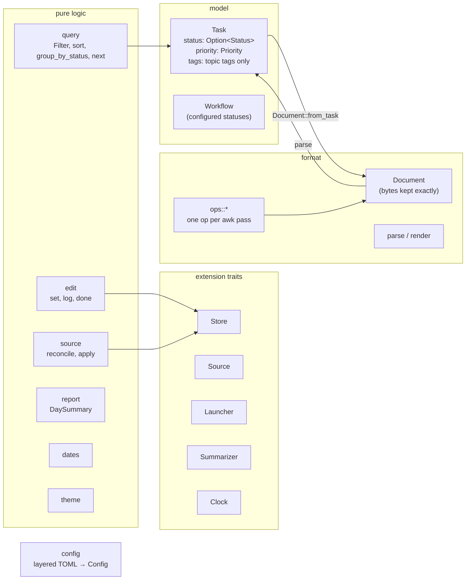
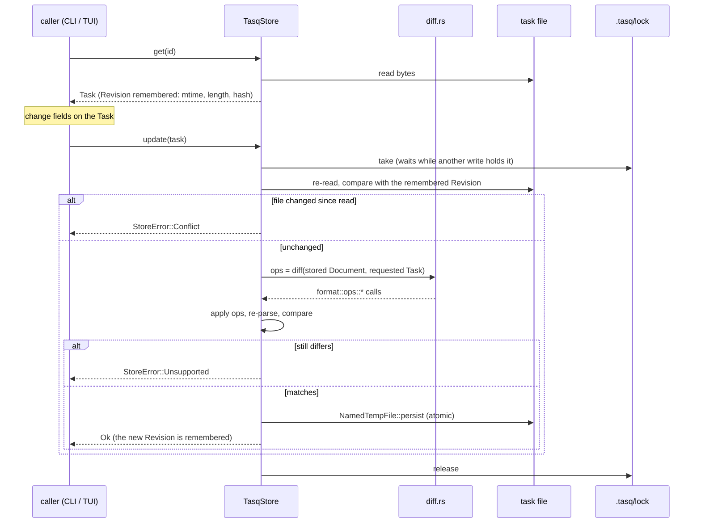
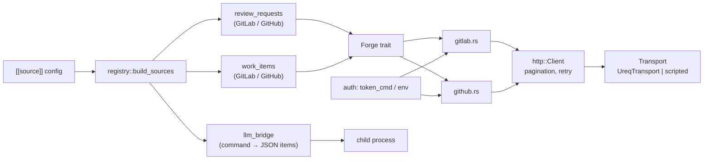
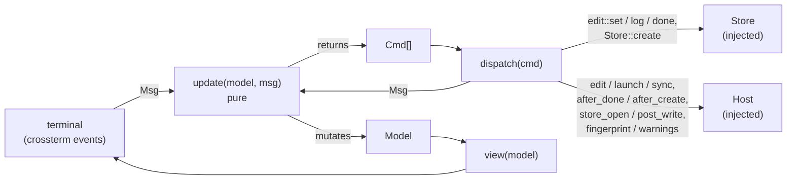
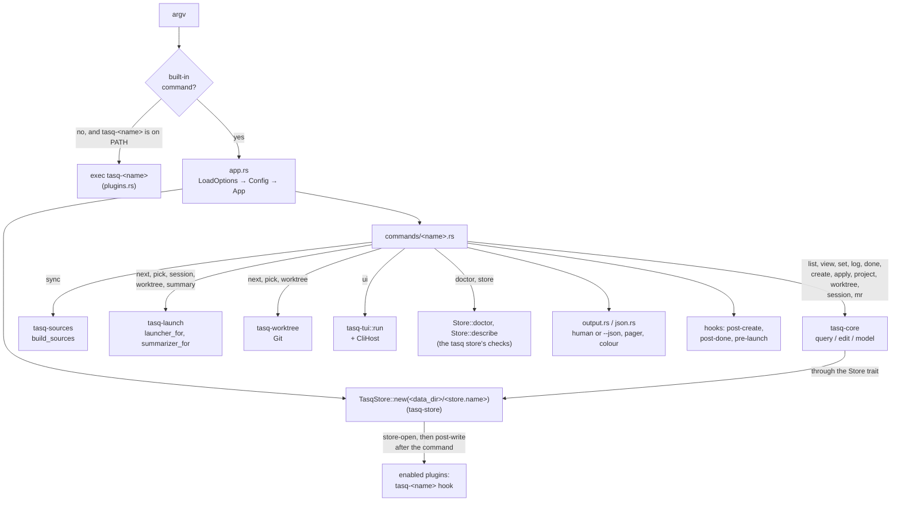
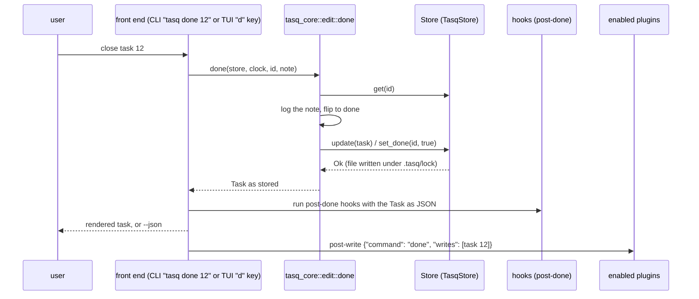

# Architecture

`tasq` is a Cargo workspace of seven crates. One crate holds the domain and knows nothing about
the outside world; the adapter crates implement its extension traits against real things (a
store directory, GitLab and GitHub, child processes, git worktrees, a terminal); one crate, the
`tasq` binary, wires them together. This document describes each crate, what it owns, and how
the crates talk to each other. The decisions behind the shape are in [`docs/adr/`](adr/README.md).

## The workspace at a glance

Dependencies flow one way, toward `tasq-core`. The adapters never depend on each other, and the
TUI depends on core only; the CLI is the single place where everything meets.

| Crate | Package | Role | Talks to the world through |
|---|---|---|---|
| `crates/core` | `tasq-core` | Domain model, lossless markdown format, queries, config, clock, reconciliation, reports, and the `Store`, `Source`, `Launcher`, `Summarizer` traits; the worktree lifecycle decisions (`worktree`). | Nothing. No filesystem, no processes, no terminal, no network. |
| `crates/store` | `tasq-store` | The `Store` the CLI opens (ADR-0026): `TasqStore` over a directory of `<ULID>.md` files with a frontmatter block. Reads (the id map is the files' frontmatter, scanned on every call; the creation time is the ULID's), `create` under the store lock (`.tasq/lock`; highest id plus one, a ULID minted from the clock, a no-clobber write), `update` and `set_done` under the same lock (conflict detection by `Revision`, `diff::apply` to the format ops, an atomic write over the file), `doctor` checks (`store`, `task-files`, `ids`, `lock`), `Revision` (mtime, length, hash) and `diff::apply` (whole-task write to `format::ops` calls). | Files. |
| `crates/sources` | `tasq-sources` | `Source` implementations: GitLab and GitHub review requests and work items over a shared forge client, and the LLM bridge that turns a command's JSON into items. | HTTPS (`ureq`); a child process for the LLM bridge and `token_cmd`. |
| `crates/launch` | `tasq-launch` | `Launcher` implementations (shell, tmux, Claude Code, herdr), the command `Summarizer` behind `tasq summary`. | Child processes, with an explicitly injected environment. |
| `crates/worktree` | `tasq-worktree` | Carries out the worktree lifecycle (ADR 0022): where a branch lives, `git worktree add` at the declared path, provisioning and the `pre-create`/`post-create` hooks around it, the release at close (removal, branch deletion, `pre-remove`/`post-remove` hooks), the declared worktrees `worktree ls` lists and their changes. | `git` child processes, with an explicitly injected environment. |
| `crates/tui` | `tasq-tui` | Full-screen terminal UI. Elm architecture over `tasq-core`; everything that needs the outside world goes through a `Host` the CLI provides. | The terminal (ratatui / crossterm). |
| `crates/cli` | `tasq` (lib `tasq_cli`) | The binary. Argument parsing, config loading, opening the store, building sources and launchers, rendering human and `--json` output, hooks and out-of-process plugins. | Everything above, plus stdout, the pager and `PATH` for plugins. |

## tasq-core

The core is the vocabulary every other crate speaks. It has no I/O of its own: time comes from
a `Clock`, configuration loading takes a `LoadOptions` naming the cwd, home and environment,
and the filesystem check in `launch::resolve_workdir` is a closure. That is what keeps the
logic cheap to run thousands of times under `cargo mutants` against temp dirs and fakes.

### Modules

| Module | What it holds |
|---|---|
| `model` | `Task`, `TaskDraft`, `TaskId`, `Status`, `Workflow`, `Priority`, `Tag`, `Link`, `Worktree`, `Session`, `ProgressEntry`, `Origin`. Plain data with validating newtypes. |
| `format` | `Document` (byte-exact file), `parse` and `render`, `ops` (the edit operations), `Document::from_task` for new files. Normative reference: [`docs/file-format.md`](file-format.md). |
| `query` | Pure functions over borrowed tasks: `Filter`, `sort`, `group_by_status`, `next`, `list`. |
| `edit` | The script's `set`, `log` and `done` as operations on a `Store`. Both front ends call these, so they cannot drift. |
| `source` | `Source` trait, `SourceItem`, `reconcile` (items vs tasks, producing `Change`s) and `apply` (writes the changes through a `Store`). |
| `launch` | `Launcher` trait, `LaunchContext`, `resolve_workdir` (first existing worktree, else the task's `project`, else `work.default_project`). |
| `work` | `project_dir`: the task's project, else `work.default_project`. |
| `worktree` | The worktree feature's pure parts: `lifecycle` (declare, `on_launch`, `on_close`), `declaration` (templates rendered into an entry), `vars`, `git` (reading `.git` files). |
| `report` | `DaySummary` from progress notes, `Summarizer` trait, `RawSummarizer`. |
| `config` | `Config` and its sub-structs, `LoadOptions`, the six layers, `Loaded::file_for` provenance. Reference: [`docs/config.md`](config.md). |
| `clock` | `Clock`, `SystemClock`, `FixedClock`, `When`, timestamp helpers. Local wall-clock time, no zone, as the script wrote it. |
| `dates` | `today`, `yesterday`, weekday names, ISO dates, report ranges. |
| `theme` | `Color` and `Theme`: colour decisions shared by CLI and TUI; rendering is the front ends' job. |
| `store` | `Store` trait (`list`, `get`, `create`, `update`, `set_done`, `describe`, `take_warnings`, `doctor`, `file_of`), `StoreError`, `StoreInfo`, `impl Store for Box<S>`, and `MemoryStore` for tests. |
| `doctor` | `Check` and `CheckStatus`, the diagnostics a `Store::doctor` reports and `tasq doctor` prints; `any_failed`. |
| `plugin` | The plugin events of ADR 0030, pure: `Event` (`store-open`, `post-write`, `doctor`), `Payload` and its JSON, `Write`/`WriteKind` (what `post-write` lists), `doctor_checks` (a plugin's answer to `doctor` as `Check`s), `warnings_file` and `warnings` (lasting warnings). Running the plugin is the CLI's job. Reference: [`docs/plugins.md`](plugins.md). |

### Two ideas that shape everything else

**The file has keys and sections, the model has fields.** A task file's frontmatter holds
`status: ready`, `priority: A`, `tags: [gitlab]` (done is `status: done`); `Task::status` is
`Some(READY)`, `Task::priority` is `A`, `Task::tags` is `[gitlab]` and `Task::done` a bool. The
format layer does the mapping both ways against the configured `Workflow`. Nothing outside
`format` asks "is this value a status?".

**Edits are operations, not diffs.** `Document` keeps every byte it does not understand: the
frontmatter's unknown keys and key order, unknown sections, blank lines, line endings. A scalar
op sets, adds or clears one frontmatter line; the list sections follow the original script's
insertion rules, which are not uniform (new sections go before `## Progress`,
`### Merge requests` nests inside `## Related`), so each rule is one function in `format::ops`. The store applies
ops, re-parses, and compares with the requested task; anything it could not express is a
`StoreError::Unsupported`, never a silent drop.

## tasq-store

The store of ADR-0026 (`ruli/features/store-v2/PLAN.md`), and the only one the CLI opens.
Reads scan the directory on every call: every non-dot `.md` file is read and parsed as a
task file, the id map is the files' frontmatter, a file that is not a task file is skipped
by `list` and reported by `doctor`, an id claimed by two files is `StoreError::AmbiguousId`
from `get` (both files named) and a warning from `list`. A directory that does not exist is
an empty store; reads never lock and never create it.

A `create` takes the store lock, `.tasq/lock` inside the directory (an exclusive create; a
lock older than two minutes is removed, a live one is waited on), reads the id map, allocates
the highest id plus one, renders the draft as a fresh document, writes it to a temp file in
the directory and renames it into place without overwriting as `<ULID>.md`, the ULID minted
from the store's clock and the OS's randomness (a name that exists gets a fresh ULID, a bounded
number of times), then releases the lock and reads the task back. The first write creates the
directory. No job, no git: dropping the lock removes the file.

An `update` takes the same lock, scans, finds the one file claiming the id and compares its
`Revision` with the one remembered when this store last handed the task out (`get`, `list`,
and the read-back at the end of `create`); a mismatch is `StoreError::Conflict` and nothing
is written. Then `diff::apply` edits the document with the format ops; a field the ops cannot
express (a removed or rewritten list entry) is `StoreError::Unsupported`, also with nothing
written. When the rendered bytes changed, they go to a temp file in the directory, given the
task file's permissions, and are renamed over it; the new revision becomes the baseline, so
the same reader can keep writing. `set_done` is the same write with the done ops (`status:
done` plus `closed` stamped from the clock; reopening drops both) and no revision check; it
leaves the baseline alone, so a task read before it conflicts on `update` until re-read. A
file whose bytes are not valid UTF-8 is read with replacement characters but refused by both
writes (`InvalidData`) when they would change it, since writing it back would replace the
bytes. Doctor adds a `lock` check: `Ok` without a lock file or with a live one, `Warn` naming a
stale one (doctor does not remove it; the next write does).

| Module | What it holds |
|---|---|
| `store` | `TasqStore`: `list`, `get`, `file_of`, `describe` (`tasq`, the directory, the task count), `doctor` (`store`, `task-files`, `ids`, `lock` checks), warnings, `create`, `update`, `set_done`; the remembered revisions; the injected `Clock` and random source (`with_clock`, `with_random`). |
| `lock` | `StoreLock`: `.tasq/lock`, taken with an exclusive create, stale after `STALE_AFTER`, released on drop; `acquire_within` waits at most a given time (`tasq store lock --timeout`), `refresh` touches its mtime so a long holder is not taken for stale. |
| `fingerprint` | `fingerprint(dir)`: a hash of the names, lengths and mtimes of the store's `.md` files, which the TUI polls to notice outside changes. |
| `draft` | `check_draft` (a merge request needs a title) and `materialize` (the default note, the done-draft rules). |
| `ulid` | `Ulid`: the file name; parse, render, and the millisecond timestamp that is the task's creation time. |
| `revision` | `Revision`: mtime, length and a content hash, captured on read and compared on write; a mismatch is `StoreError::Conflict`. |
| `diff` | `apply`: edits the stored `Document` with `format::ops` until its projection equals the requested `Task`, or names the fields it could not express (`StoreError::Unsupported` in the caller). |

## tasq-sources

`Source` implementations for `tasq sync`. All HTTP goes through the injected `Transport` trait,
so every client is tested against scripted responses and `cargo test` never touches the
network. `UreqTransport` is the real one.

| Module | What it holds |
|---|---|
| `registry` | `build_source(s)` from `[[source]]` blocks into `Built { name, source, policy, … }`. |
| `forge` | The `Forge` trait: what the two sources need from GitLab or GitHub, plus shared JSON helpers. `MergeRequest`, `WorkItem`, `User`. |
| `gitlab`, `github` | The two `Forge` clients. |
| `review_requests`, `work_items` | The `Source` implementations built on `Forge`. |
| `llm_bridge` | A configured command prints a JSON array of items; parsed and deduplicated. Contract in [`docs/sources.md`](sources.md). |
| `http` | `Client` over `Transport`: JSON decoding, `Link` pagination, backoff on 429 and 5xx. |
| `auth` | Tokens via `token_cmd` (`glab config get token --host <host>`, `gh auth token`) or `GITLAB_TOKEN` / `GITHUB_TOKEN`. Never printed. |
| `url`, `title` | Parsing MR and issue URLs, and resolving titles for `tasq mr`. |

The reconciliation itself (which items become tasks, which tasks get closed) is not here. It is
`tasq_core::source::reconcile`, pure and mutation-tested; this crate only fetches.

## tasq-launch

Process-running adapters. Every process gets an explicitly injected environment, so tests point
`PATH` at fake executables.

| Module | What it holds |
|---|---|
| `registry` | `launcher_for(name)`, `LAUNCHER_NAMES`, `LaunchSettings`; `resolve_window` for `launch.window` (`auto` is herdr inside herdr, tmux inside tmux, else an error). |
| `shell`, `tmux`, `claude`, `herdr` | The four `Launcher`s. `herdr` is behind the default-on `herdr` feature; `launch.herdr.placement` says whether it opens a workspace or a tab. `tmux` and `herdr` honour `LaunchContext::focus` (ADR-0012). |
| `prompt` | The tiny template engine (`{{name}}`, `{{#name}}…{{/name}}`) behind the Claude prompt. Templates are data, in `templates/`. |
| `env` | Environment strategy: run through `direnv exec` so the session gets the target directory's `.envrc`, or inherit. |
| `summarizer` | `CommandSummarizer`: the configured command (default `claude -p`) that distils a day's notes for `tasq summary`. |
| `process` | Running external programs with an injected environment. |
| `which` | `find_in_path` and `tool_check`: finding the optional tools on an injected `PATH`, for `tasq doctor`'s tool checks and `glow` in `tasq view`. |

The pure part of launching, where a session starts (`resolve_workdir`), lives in
`tasq_core::launch`; this crate only runs things.

## tasq-tui

The second consumer of `tasq-core` and the proof of the core/UI boundary (ADR-0005). It depends
on `tasq-core` and ratatui only. The architecture is Elm's.

| Module | What it holds |
|---|---|
| `model` | `Model`, `Mode`, `NoteTarget`: what is on screen and what the keys mean right now. |
| `msg` | `Msg`, `Cmd`, the `Host` trait, `NoHost` and `RecordingHost` for tests. |
| `update` | The pure state transition. |
| `view` | Drawing the model with ratatui widgets, colours from `tasq_core::theme`. |
| `keys` | Key bindings. |
| `runtime` | `dispatch` (runs one `Cmd` against store, clock and host; touches no terminal) and `run` (owns raw mode and the alternate screen). |

Every edit the UI makes is one of the `tasq_core::edit` functions the CLI uses, and `c` opens
the edit view empty and creates the task through `Store::create`, starting from the configured
default status and the directory `tasq ui` runs in as its project (both handed over by the
CLI); the worktree it declares comes from the host (`Host::worktree`, the same rules as
`tasq create`). The three actions
that need the outside world (open an editor, start a work session, run a sync) are `Host`
methods; the CLI implements them by running itself (`tasq pick <id>`, `tasq sync`) while the
UI has released the terminal (ADR-0009). A work session in a new window (`Ctrl+Enter`,
`Shift+Enter`) is `Host::launch` with a `LaunchTarget::Window`; the CLI runs
`tasq pick <id> --window [--no-focus]` with its output captured, so the UI keeps the screen
and shows the result in the status bar (ADR-0012). The `d` and `c` keys also reach the
`post-done` and `post-create` hooks through `Host::after_done` and `Host::after_create`
(ADR-0010, ADR-0011).

The plugin events reach the UI through the `Host` as well (ADR 0030): `Host::store_open` on
`r` (the CLI already sent `store-open` when it opened the store for `tasq ui`),
`Host::post_write` after every action, which the CLI turns into one `post-write` when the
action wrote, and `Host::warnings`, the lasting warnings shown in the status bar. Every
`runtime::TICK` (2 s) `run` asks `Host::fingerprint` and, in normal mode, reloads through
`Cmd::Load` when it changed, keeping the selection by id; the UI itself never touches the
store directory.

## tasq (the CLI)

The binary and the composition root. It is deliberately thin: every command is a core function
or a `Store` call followed by rendering, and every command accepts `--json`. The library
(`tasq_cli`) holds all commands so unit tests can exercise them; `main.rs` is one line.

| Module | What it holds |
|---|---|
| `cli` | The clap definitions. |
| `app` | Wiring: process state → `LoadOptions`, config → `App`, `App` → open store, `TASQ_NOW` fixed clock. |
| `commands/*` | One module per command; each `run` is a core or store call plus rendering in human and `--json` form. |
| `output` | Colour decision (`NO_COLOR`, `--color`), ANSI styling, pager (`ui.pager`, default `less -RFX`), JSON emission. |
| `json` | The `--json` envelope: `{"schema": 1, …}`. Tasks serialise exactly as `tasq_core::model::Task`, which `tasq apply` reads back. Reference: [`docs/json.md`](json.md). |
| `error` | CLI error type and exit codes: `0` ok, `1` user error, `2` usage or internal error. |
| `plugins` | Out-of-process plugins: dispatch to `tasq-<name>`, the three hooks, `tasq plugins list`, the enabled plugins and their events (`fire`: `tasq-<name> hook` with the payload on stdin, own process group, `plugins.timeout`), lasting warnings and the plugins' `doctor` checks. Reference: [`docs/plugins.md`](plugins.md). |
| `interrupt` | `Watch`: while a plugin handles an event, SIGINT sets a flag (`signal-hook`) that the runner checks to pass the Ctrl-C on to the plugin's process group; otherwise SIGINT does its default. |
| `writes` | `Recording`, the `Store` decorator `App::open_store` puts around the store while a plugin listens: it notes each task whose file a write changed, for the `post-write` sent after the command (`App::post_write`). |

The CLI is the only crate that knows all the others exist. It builds the concrete `TasqStore` (`App::open_store`),
`Box<dyn Source>`s, `Box<dyn Launcher>`s and the TUI's `Host`, and hands them to code that only
sees the traits.

## Outside the crates

| Path | What it is |
|---|---|
| `plugins/claude/` | The Claude Code plugin: `/tasq:wrapup` and `/tasq:sync` skills plus a status line script. Everything goes through the `tasq` CLI with `--json`. The repository doubles as a one-plugin marketplace. |
| `examples/` | Example configs, a reference plugin (`tasq-tlogs`), the event-logging plugin the event tests use (`tasq-echo`), a hook, and an LLM-bridge source setup. |
| `homebrew/` | The Homebrew formula template used by the release workflow. |
| `scripts/guard`, `scripts/test-runner` | Memory-capped wrappers every cargo invocation goes through (see `CONTRIBUTING.md`). |
| `original/tasks` | The bash script this project rewrites. Never modified. |
| `ruli/features/rust-rewrite/` | `PLAN.md` (tasks, acceptance criteria, decisions) and `PROGRESS.md` (status, learnings). |
| `ruli/features/<slug>/` | One plan and progress log per larger task since then, e.g. `store-v2/` for ADR-0026. |
| `docs/adr/` | Architecture decision records. |

## How a change moves through the system

The same edit, from either front end:

The front end never touches a file or a tag; it calls one core function and renders the result.
The store it calls is wrapped by the CLI's `Recording` while a plugin listens, which is how
the `post-write` at the end knows what was written without core or the store knowing about
plugins.

## Testing shape

The dependency direction is what makes the test strategy work:

| Crate | How it is tested |
|---|---|
| `tasq-core` | Unit and integration tests, property tests (`proptest`) for format round trips, byte-identical fixtures in `tests/fixtures/*.md` and op before/after pairs in `tests/fixtures/ops/`. Mutation-tested with zero missed mutants as the acceptance bar. |
| `tasq-store` | Unit tests on `revision`, `diff`, `lock` and `draft`; integration tests through the `Store` trait over a temporary directory (`tests/support/mod.rs` builds a `TempStore`; `open_with` freezes the clock and scripts the random part of minted ULIDs, so file names are predictable and a name collision can be forced); no `git`. Mutation-tested (`just mutants-in crates/store/src`). |
| `tasq-sources` | Unit tests with a scripted `Transport`; no network in `cargo test`. |
| `tasq-launch` | Fake executables on an injected `PATH`; `insta` snapshots of the commands that would run. |
| `tasq-worktree` | Real `git` against temporary repositories: a bare `origin`, a clone to work in, a second clone that pushes branches. Mutation-tested. |
| `tasq-tui` | `dispatch` against `MemoryStore` and `RecordingHost`; `insta` snapshots of rendered frames. |
| `tasq` (CLI) | Integration tests run the binary against a copy of the fixture store and snapshot its output with `insta`. Not mutation-tested; the logic lives in core. |

Conventions, the fixture store and the mutation-testing workflow: [`docs/testing.md`](testing.md).
